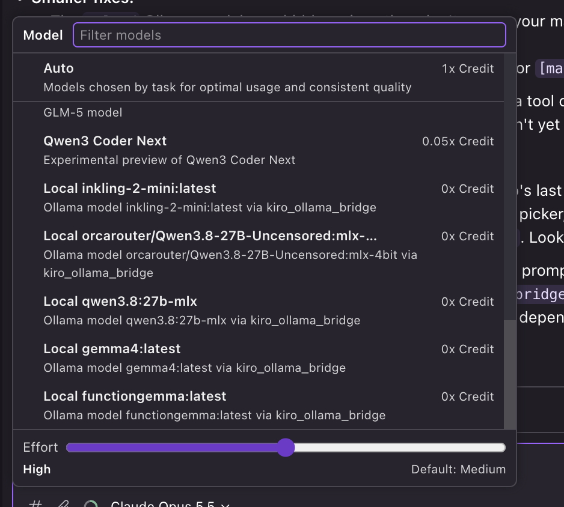

# kiro-ollama-bridge

Use local [Ollama](https://ollama.com) models in Kiro IDE, from Kiro's own model picker, next to your subscription's cloud models.



*Kiro's model picker with the bridge running. The "Local …" entries are Ollama models on this machine.*

> **Unofficial.** This project is not affiliated with or endorsed by Amazon or Kiro. It relies on undocumented Kiro settings that can change or disappear in any release. Verified with Kiro IDE **1.2.37** and Ollama **0.40** on macOS (November 2026).

## Requirements

- Kiro IDE, signed in. Cloud models keep using your normal Kiro login and subscription.
- Ollama running locally (`http://127.0.0.1:11434`) with at least one chat model. For agent work, choose a model with the `tools` capability.
- Python 3.9+. The bridge uses only the standard library, so there's nothing to install.

## How it works

Kiro reads two settings that aren't in its Settings UI. Each replaces one of Kiro's backend hosts for a region:

| Setting | Replaces | Used for |
|---|---|---|
| `codewhisperer.config.krsEndpoints` | `runtime.<region>.kiro.dev` | chat (`/v1/responses`, `/generateAssistantResponse`), feature config, MCP |
| `codewhisperer.config.cpsEndpoints` | `management.<region>.kiro.dev` | model list (`ListAvailableModels`), usage, profile |

The bridge listens on both and forwards every request to the real Kiro host unchanged, with three exceptions:

- **Model list:** it appends your Ollama models as `local-<name>` entries (0 credits, text input).
- **Chat on `/v1/responses`** for a `local-…` model: translated to Ollama `/api/chat` and streamed back as the Responses-API SSE events Kiro parses.
- **Chat on `/generateAssistantResponse`** for a `local-…` model: same, streamed back as an AWS event stream.

A server-side flag decides which chat path Kiro uses for your account, so the bridge supports both. Tool calls and tool results are translated in both directions, so local models can use Kiro's tools.

## Setup

1. Start the bridge and leave it running:
   ```bash
   nohup python3 kiro_ollama_bridge.py > bridge.log 2>&1 &
   tail -f bridge.log
   ```
2. Copy `vscode-settings.example.jsonc` into `.vscode/settings.json` of the project you want to use it in. This limits the bridge to windows that open that folder. Kiro reads workspace values for these settings only in a **trusted** workspace. To use the bridge everywhere, put the same two keys in your user settings instead.
3. Reload the Kiro window: Command Palette → **Developer: Reload Window**. Kiro reads the endpoint settings only at startup.
4. In a **new** session, open the model picker and choose a **Local …** model. Kiro refreshes the model list every 5 minutes; the log shows `ListAvailableModels -> N models (M local)` when it does.

**To undo,** delete the two keys and reload. Keep the bridge running whenever the settings are set; otherwise all chat in that window fails.

## Options

| Flag | Default | Notes |
|---|---|---|
| `--num-ctx` | 65536 | Ollama context window, also reported to Kiro as the model's input limit. |
| `--think on\|off\|default` | off | Ollama thinking. Off is much faster for agent turns. |
| `--show-thinking` | off | Forward model thinking to Kiro as reasoning. |
| `--include-cloud` | off | Also list Ollama `:cloud` models, which don't run locally. |
| `--region` | us-east-1 | Which Kiro region to forward to. Use the region of your Kiro profile, and match it in the settings. |
| `--runtime-port` / `--management-port` | 8787 / 8788 | Must match the settings. |
| `--ollama` | `http://127.0.0.1:11434` | Ollama base URL. |

## Limits

- **Context size.** Kiro's system prompt and tool definitions are large, and long sessions reach hundreds of thousands of tokens. When a prompt clearly won't fit `--num-ctx`, the bridge answers with an explanation instead of letting Ollama silently cut the start of the conversation. Use new sessions, and raise `--num-ctx` if your RAM allows.
- **Text only.** Images and file attachments are dropped for local models.
- **Agent quality depends on the model.** Small models often handle Kiro's tool protocol poorly.
- **No Kiro-side features for local turns.** Metering, prompt caching and reasoning replay apply only to cloud models.

## Security

- **The bridge sees your Kiro token.** Kiro sends its bearer token on every request, and the bridge forwards it to Kiro's real hosts over HTTPS. The bridge binds to `127.0.0.1` only and never logs the token. Don't change the bind address.
- **Kiro warns about plain HTTP.** Kiro logs "bearer token will be sent over an unencrypted connection" because the endpoint is `http://`. The token only travels over loopback to the bridge.
- **Local requests never reach Kiro's servers.** Requests for `local-…` models go only to Ollama.
